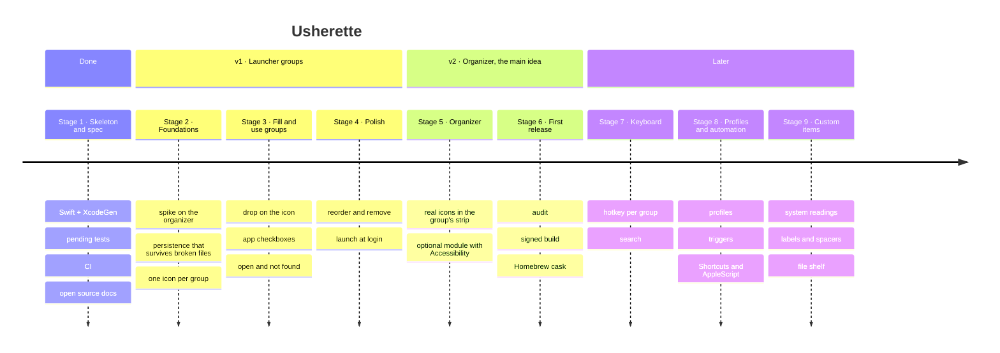

# Usherette — handoff

**Status:** groups open as a strip of icons; other apps' icons are hidden behind a marker, moved there automatically when added to a group, and opened from it (notch displays only); no launcher items yet · **Last updated:** 2026-11-17
**Language:** Swift 6 (see `docs/adr/0001-language.md`) · **Shape:** lightweight hexagonal (`docs/adr/0002-hexagonal-shape.md`)
**Run:** `xcodegen generate && open Usherette.xcodeproj` · **Tests:** `swift test --package-path Core` · **Lint:** `./scripts/lint.sh` · **Deploy:** none (desktop app: manual release)

## Resume here

State when the last session closed (2026-11-17):

- **PR #24 is open and not merged** (branch `fix/marker-click-and-desktops`, CI green). It
  closes #23 (clicking the ‹ marker did nothing; the settings window sent macOS back to
  another desktop) and adds the notice for when macOS draws none of Usherette's icons.
  Merge it once the QA below looks right.
- **Run the app from `~/Applications/Usherette.app`,** not from `build/`. On 2026-11-15, after
  a long sleep, macOS stopped drawing any icon of the copy in `build/…/Usherette.app`; the same
  build copied elsewhere works. Copy each new build there with
  `ditto build/Build/Products/Debug/Usherette.app ~/Applications/Usherette.app` while the app
  is not running. Why it happened is spike #25.
- **QA waiting on a person** (things the agent could not simulate):
  | # | Check | Expected |
  |---|---|---|
  | A | Open settings on one desktop, switch to another, open settings again | It shows on the current desktop; macOS does not switch |
  | B | Click the group icon twice, with a real mouse | The strip opens and closes |
  | C | Right-click the group icon → "Show Hidden Icons", then click ‹ | Icons come back, then hide again |
  | D | First "Allow Accessibility…" ever | macOS asks; once allowed, the list of menu bar apps appears |
  | E | Let the Mac sleep for a while with hiding on | On wake the group icon is there and the icons are still hidden |
  | F | Move the mouse while Usherette is moving an icon | It retries or names the icon; it never moves another one |
  | G | Light appearance, an external display, Teams/Docker/Discord in a group | Same behaviour as on the notch display in dark mode |
  E decides #25: if everything is still there, the cause was rebuilding over a running copy;
  if the icons disappear again, the wide marker is the cause and needs to change on sleep.
- Local branches `backup/main-antes` and `backup/pr-antes` hold history from before the
  co-author trailers were removed (2026-11-15). Not pushed; safe to delete.
- The local folder is still called `~/Developer/multibar`; the repository is `usherette`.

## Roadmap

| Stage | What it includes | Status | Criteria (SPEC) | Issues |
|---|---|---|---|---|
| 1 · Skeleton and spec | language, shape, SPEC, empty tests, CI, contributor docs | ✅ | — | — |
| 2 · Foundations | spike on the organizer, JSON config, one `NSStatusItem` per group | ✅ | AC-1, AC-7, AC-8 | #8, #2, #1 |
| 3 · Fill and use groups | drop on the icon, URLs, checkboxes, opening | ⏳ | AC-2, AC-3, AC-4, AC-5, AC-9 | #3, #4, #5 |
| 4 · Polish | reorder, remove, launch at login | ⏳ | AC-6, AC-10 | #6, #7 |
| 5 · Organizer (v2) | marker that hides icons (no permission); opt-in module that lists, moves and opens other apps' icons from the group's strip | 🔧 first slices done | AC-11 to AC-16 | #14, #19, #21, #23, #25 |
| 6 · First release | audit, docs, signed release, Homebrew cask `usherette` | ⏳ | all so far | — |
| 7 · Keyboard | hotkey per group, search across groups | ⏳ | to write | — |
| 8 · Profiles and automation | profiles, triggers, Shortcuts, AppleScript | ⏳ | to write | — |
| 9 · Custom items | system readings, labels, spacers, file shelf | ⏳ | to write | — |

What is in and out compared with the reference product is in the parity table of `SPEC.md` §7.

## What was done (latest first)
- 2026-11-17 · Handoff updated before closing the session; nothing else changed.
- 2026-11-15 · The app notices when macOS draws none of its icons, says so in the settings
  window and opens it. The cause is not known; what is known is in the spike notes.
- 2026-11-15 · Clicking the ‹ marker hides the icons; the group menu can show and hide them;
  the settings window follows the desktop in use. Found that macOS has its own « overflow.
- 2026-11-15 · #21: a group opens as a strip of icons under the menu bar instead of a text
  menu; a right-click gives Settings and Quit. AC-16, checked by hand.
- 2026-11-15 · #19: icons are placed for the user. Adding a menu bar app to a group moves its
  icon behind the marker, removing it from its last group brings it back. AC-15 passes.
- 2026-11-15 · App icon, code of conduct, issue forms, repository description and topics.
- 2026-11-15 · #14: first slice of the organizer. A marker hides the icons on its left with no
  permission; with Accessibility, menu bar apps can be added to a group and opened from it.
  AC-11 to AC-14 pass. Found that a synthetic ⌘-drag moves icons (`docs/spikes/0008-organizer.md`).
- 2026-11-15 · #1: groups in the menu bar. `CreateGroup` use case, one status item per group,
  settings window to add groups, notice when the configuration was set aside. AC-1 passes.
- 2026-11-15 · #2: configuration persistence. Domain types (`Configuration`, `Group`,
  `GroupIcon`, `Item`), the `ConfigStore` port and `JSONConfigStore`; AC-7 and AC-8 pass.
- 2026-11-15 · Spike #8 run on macOS 27.2: the main idea works with Accessibility alone;
  hiding needs no permission. Results in `docs/spikes/0008-organizer.md`.
- 2026-11-15 · Scope set against Bartender 7 and Pro: parity table in the spec, roadmap
  extended to stages 6–9. ADR 0003 rewritten: no permissions by default, Accessibility only in
  an opt-in module, never Screen Recording.
- 2026-11-15 · Renamed from Multibar to Usherette (repository, app, modules, bundle id,
  configuration folder). `Core` split into `Domain/`, `UseCases/` and `Ports/`; design rules
  written in `docs/DESIGN.md`.
- 2026-11-15 · Docs, tests and templates moved to English; README as a product page;
  `CONTRIBUTING.md` and `SECURITY.md`; privacy principles added to the spec and enforced in
  lint. Private vulnerability reporting enabled on GitHub.
- 2026-11-13 · Project start: Swift + XcodeGen, `Core/` package (domain and persistence)
  separate from `App/`, SPEC with 10 criteria, one pending test per criterion, CI, Dependabot,
  license, 8 issues.

## What is next
1. QA above, then merge PR #24.
2. Spike #25: what makes macOS stop drawing all of an app's icons. Check E above first.
3. Stage 3: #3 (drop on the icon), #5 (open an item) and #4 (app checkboxes).
4. Displays without a notch, Teams and other apps, macOS 26.

## How hiding works, in plain words
Users asked why one Usherette icon makes three others disappear. It is not the group icon:
it is the ‹ marker. While hiding, the marker is made transparent and wide enough to reach the
notch (about 250 pt on a 14-inch MacBook). macOS hides an icon only when there is no room
left for it, so everything on the marker's left loses its place and goes to macOS's own
overflow, the « that appears in the bar. Clicking « shows them on the left, over the app's
menus. The empty-looking stretch of the bar is the marker. A new app's icon lands at the left
end of the bar, so it starts hidden until moved to the right of the marker.

## Working on this repository
- **No Claude co-author.** Commits and pull requests carry no `Co-Authored-By: Claude` line and
  no "Generated with Claude Code" footer. The owner asked for this explicitly.
- **Check with real mouse events.** Pressing controls through Accessibility skips the mouse
  monitors and hides bugs (the strip that would not close was one). Post click events, and
  capture the whole menu bar (`screencapture -x -R 0,0,<width>,33`), not only the right of
  the notch.
- **Never drive the copy the owner is using.** Start a trial copy with
  `USHERETTE_CONFIG_DIR=/some/folder <path>/Usherette.app/Contents/MacOS/Usherette`; it keeps
  its icons under other names so it can run beside the real one. Remove the
  `NSStatusItem Preferred Position trial-…` keys from `io.github.malenitaa.Usherette` after.
- **Do not rebuild while the owner's copy runs from `build/`.** It may be what triggered #25.
- The small Swift programs used to drive the app in testing (press, read the bar, post
  clicks) lived in a session scratch folder and are gone. Each was a few dozen lines over
  `AXUIElement` and `CGEvent`; `docs/spikes/0008-organizer.md` has the calls.

## Decisions taken (open to veto)
- **The main idea is the organizer:** a group opens a strip with other apps' real icons, and
  profiles swap what the bar shows. It depends on the opt-in module, so spike #8 decides how
  much of it is possible. If the spike says no, the first release is the launcher alone.
- **A group opens as a strip of icons** under the menu bar, not as a text menu.
- **Permissions (ADR 0003):** none by default; Accessibility only for the opt-in organizer
  module; never Screen Recording.
- **Out on purpose:** menu bar styling, a secondary bar, notch recovery, search over other
  apps' items, clipboard history, calendar, weather (SPEC §7).
- **Apache-2.0 license** (`LICENSE`, `NOTICE`, README).
- **Minimum macOS 15** (`project.yml`, `Core/Package.swift`).
- **No sandbox, not on the Mac App Store** (ADR 0001).
- **No shell commands as items and no custom scripts;** Shortcuts (`shortcuts://`) cover
  "anything else" (SPEC §3).
- **Group icon = SF Symbol or emoji;** custom images come later. There is one text field:
  an emoji is kept as emoji, anything else is read as a symbol name.
- **The strip has a settings button at its end,** and a right-click on the group icon gives
  Settings and Quit. The strip wraps after eight icons.
- **Group names can repeat;** only an empty name is refused.
- **Docs and code in English.**
- **Name: Usherette** for the app, the executable, the repository and the future Homebrew
  cask (`usherette`); the name was free on Homebrew and GitHub on 2026-11-15.
- **Issue labels in English:** `feature`, `tech-debt`, `security`.

## To decide
- Whether to sandbox the default install (ADR 0003).
- Issues for stages 5 and 7–9 are not open yet; open them after spike #8.
- Audio controls: low priority, only if a way that does not rely on a private API turns up.

## Known debts
- No UI tests for the menu bar (end-to-end): manual check in `docs/DESIGN.md`. Checks made by
  pressing controls through Accessibility miss bugs that only real mouse clicks show (the
  strip not closing on a second click was one); post real click events when checking, and
  capture the whole menu bar, not only the right of the notch.
- **Unexplained: macOS stopped drawing Usherette's icons** after a long sleep, for the copy in
  `build/` only. The advice shown to the user (check the switch, turn it off and on) is a guess
  that has not been seen to work. See `docs/spikes/0008-organizer.md`.
- Not checked: that the settings window no longer makes macOS switch desktops. It needs a
  person with more than one desktop.
- Hiding works only on a display with a notch.
- Opening one hidden icon shows all the hidden ones while its menu is open, and the menu
  appears under the real icon, not under the group.
- Each icon move blocks the app for under a second and takes the pointer; if the user moves
  the mouse at that moment the drag can miss, and it is tried again.
- During one test run the settings window closed by itself once; not reproduced, cause unknown.
- A locally built app is signed ad hoc, so macOS forgets its Accessibility permission on every
  rebuild. A stable signing identity fixes that (stage 6).
- Signed and notarized release: handled in stage 6.

## Where everything is
| What | Where |
|---|---|
| Spec, criteria and parity table | `SPEC.md` |
| Decisions | `docs/adr/` |
| Internal design and design rules | `docs/DESIGN.md` |
| Spike results | `docs/spikes/` |
| For users and contributors | `README.md`, `CONTRIBUTING.md`, `CODE_OF_CONDUCT.md`, `SECURITY.md` |
| Issues | https://github.com/malenitaa/usherette/issues |
