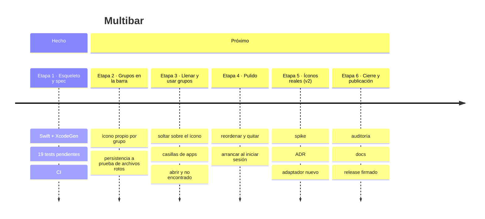

# Multibar — handoff

**Estado:** esqueleto, spec y roadmap listos; la app compila pero todavía no hace nada · **Última actualización:** 13/11/2026
**Lenguaje:** Swift 6 (ver `docs/adr/0001-lenguaje.md`) · **Forma:** hexagonal liviana (`docs/adr/0002-forma-hexagonal.md`)
**Correr:** `xcodegen generate && open Multibar.xcodeproj` · **Tests:** `swift test --package-path Core` · **Lint:** `./scripts/lint.sh` · **Deploy:** no tiene (app de escritorio: release manual)

## Roadmap

| Etapa | Qué incluye | Estado | Criterios (SPEC) | Issues |
|---|---|---|---|---|
| 1 · Esqueleto y spec | lenguaje, forma, SPEC, tests vacíos, CI | ✅ | — | — |
| 2 · Grupos en la barra | un `NSStatusItem` por grupo, config JSON | ⏳ | CA-1, CA-7, CA-8 | #1, #2 |
| 3 · Llenar y usar grupos | drop sobre el ícono, URLs, casillas, abrir | ⏳ | CA-2, CA-3, CA-4, CA-5, CA-9 | #3, #4, #5 |
| 4 · Pulido | reordenar, quitar, inicio de sesión | ⏳ | CA-6, CA-10 | #6, #7 |
| 5 · Íconos reales (v2) | Teams, Claude, Maccy adentro de un grupo | ⏳ spike | se escriben después del spike | #8 |
| 6 · Cierre | `/cierre-proyecto` completo | ⏳ | todos | — |

## Qué se hizo (lo último arriba)
- 13/11 · `/inicio-proyecto`: Swift + XcodeGen, package `Core/` (dominio y persistencia) separado
  de `App/`, SPEC con 10 criterios, un test pendiente por criterio, CI, Dependabot, licencia,
  8 issues abiertos.

## Qué sigue
1. #2 (persistencia) y #1 (grupos en la barra): los dos están `ready` y son la base del resto.
2. #8 (spike de íconos reales) se puede hacer en paralelo: define si la v2 existe.

## Decisiones que tomé (para vetar)
- **Alcance v1 = lanzador;** íconos reales de otras apps quedan para la v2 tras el spike #8 (confirmado en el chat).
- **Licencia Apache-2.0** (`LICENSE`, `NOTICE`, README): es el default para apps que otros instalan. ChargeCap usa MIT; si preferís la misma, se cambia ahora antes de publicar nada.
- **macOS 15 como mínimo** (`project.yml`, `Core/Package.swift`).
- **Sin sandbox y fuera del App Store** (ADR 0001): abrir archivos arbitrarios y la v2 con Accesibilidad lo hacen inviable.
- **Sin comandos de shell como ítem;** para "cualquier cosa" se usan Atajos (`shortcuts://`) (SPEC, sección 3).
- **Ícono del grupo = SF Symbol o emoji;** imágenes propias quedan para después.
- **Código en inglés, docs en castellano,** como ChargeCap.
- **Sin `Team.yml` opcional:** XcodeGen 2.46 falla si el archivo no existe aunque esté marcado `optional`; la firma se elige en Xcode o con `DEVELOPMENT_TEAM`.

## Para decidir
- Nada pendiente.

## Pendientes y deudas conocidas
- Sin UI tests de la barra (end-to-end): chequeo manual en `docs/DISENO.md`.
- Release firmado y notarizado: se resuelve en la etapa 6.

## Dónde está todo
| Qué | Dónde |
|---|---|
| Spec y criterios | `SPEC.md` |
| Decisiones | `docs/adr/` |
| Diseño interno | `docs/DISENO.md` |
| Para externos | `README.md` |
| Issues | https://github.com/malenitaa/multibar/issues |
