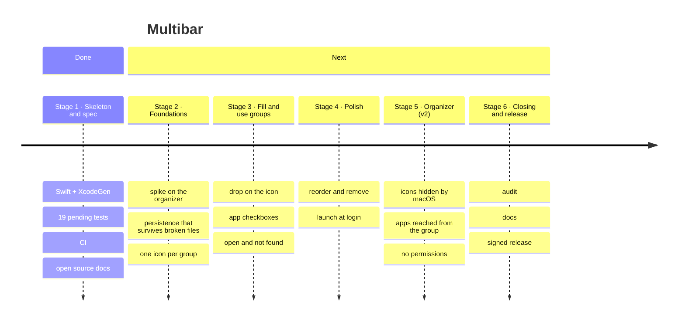

# Multibar — handoff

**Status:** skeleton, spec and roadmap ready; the app builds but does nothing yet · **Last updated:** 2026-11-15
**Language:** Swift 6 (see `docs/adr/0001-language.md`) · **Shape:** lightweight hexagonal (`docs/adr/0002-hexagonal-shape.md`)
**Run:** `xcodegen generate && open Multibar.xcodeproj` · **Tests:** `swift test --package-path Core` · **Lint:** `./scripts/lint.sh` · **Deploy:** none (desktop app: manual release)

## Roadmap

| Stage | What it includes | Status | Criteria (SPEC) | Issues |
|---|---|---|---|---|
| 1 · Skeleton and spec | language, shape, SPEC, empty tests, CI, contributor docs | ✅ | — | — |
| 2 · Foundations | spike on the organizer, JSON config, one `NSStatusItem` per group | ⏳ | AC-1, AC-7, AC-8 | #8, #2, #1 |
| 3 · Fill and use groups | drop on the icon, URLs, checkboxes, opening | ⏳ | AC-2, AC-3, AC-4, AC-5, AC-9 | #3, #4, #5 |
| 4 · Polish | reorder, remove, launch at login | ⏳ | AC-6, AC-10 | #6, #7 |
| 5 · Organizer (v2) | other apps' icons hidden with macOS's own setting and reached from a group | ⏳ after the spike | written after the spike | #8 |
| 6 · Closing | audit, docs, release | ⏳ | all | — |

## What was done (latest first)
- 2026-11-15 · ADR 0003: no Accessibility, no Screen Recording; v2 relies on macOS's own
  setting to hide icons. Private vulnerability reporting enabled on GitHub.
- 2026-11-15 · Docs, tests and templates moved to English; README as a product page;
  `CONTRIBUTING.md` and `SECURITY.md`; privacy principles added to the spec and enforced in lint.
- 2026-11-13 · Project start: Swift + XcodeGen, `Core/` package (domain and persistence)
  separate from `App/`, SPEC with 10 criteria, one pending test per criterion, CI, Dependabot,
  license, 8 issues.

## What is next
1. #8 (spike) first: how far the organizer goes with no permissions.
2. #2 (persistence) and #1 (groups in the bar): both `ready`, the base for everything else.

## Decisions taken (open to veto)
- **v1 = launcher groups; v2 = organizer** without Accessibility or Screen Recording
  (ADR 0003), after spike #8.
- **Apache-2.0 license** (`LICENSE`, `NOTICE`, README).
- **Minimum macOS 15** (`project.yml`, `Core/Package.swift`).
- **No sandbox, not on the Mac App Store** (ADR 0001).
- **No shell commands as items;** Shortcuts (`shortcuts://`) cover "anything else" (SPEC §3).
- **Group icon = SF Symbol or emoji;** custom images come later.
- **Docs and code in English.**
- **Issue labels in English:** `feature`, `tech-debt`, `security` (were `resultado`, `deuda`,
  `seguridad`).

## To decide
- Whether to sandbox the app now that Accessibility is off the table (ADR 0003).

## Known debts
- No UI tests for the menu bar (end-to-end): manual check in `docs/DESIGN.md`.
- Signed and notarized release: handled in stage 6.

## Where everything is
| What | Where |
|---|---|
| Spec and criteria | `SPEC.md` |
| Decisions | `docs/adr/` |
| Internal design | `docs/DESIGN.md` |
| For users and contributors | `README.md`, `CONTRIBUTING.md`, `SECURITY.md` |
| Issues | https://github.com/malenitaa/multibar/issues |
